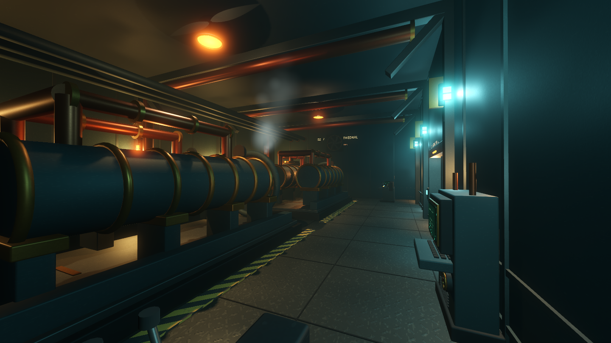

# NOCTURNE — Godot Flyship

검은 밤에 정박한 스팀펑크 연구 비행선 **NOCTURNE / HULL 07**. 거대한 기관과 황동 배관, 차가운 작업등 사이를 걷는 3D 1인칭 탐험 시뮬레이션입니다.



## 실행

- **Godot 4.6.1 이상 Standard 버전**에서 `project.godot`을 가져오고 **F5**를 누르세요. .NET은 필요하지 않습니다.
- 이 작업 폴더에서는 **`Play.cmd`를 더블클릭**해 바로 실행할 수 있습니다. 로컬 검증용 Godot 엔진은 `.tools/godot/`에 있습니다. 엔진 자체는 Git에 포함하지 않습니다.
- **`builds/Nocturne.exe`**는 설치 없이 실행하는 로컬 Windows 미리보기입니다. 같은 폴더의 `Nocturne.pck`가 필요합니다. 편집기 바이너리를 런타임으로 포함한 개발용 패키지이며, 배포 최적화된 정식 빌드는 아래 내보내기 설정으로 만들 수 있습니다. 빌드 파일은 Git에 포함하지 않습니다.
- 기본 렌더러는 **Forward+**입니다. Vulkan을 지원하는 외장 GPU를 권장합니다. 저사양 기기는 실행 시 `--rendering-method gl_compatibility`로 대체 렌더러를 선택할 수 있습니다. 이 모드에서는 입체 안개와 일부 간접광 효과가 제외됩니다.
- 처음 실행할 때 GPU 셰이더 준비로 잠시 지연될 수 있습니다.

## 조작

| 입력 | 동작 |
| --- | --- |
| Enter / 시작 버튼 | 선내 진입 |
| WASD / 방향키 | 이동 |
| 마우스 | 시점 회전 |
| Shift | 빠르게 이동 |
| Ctrl | 앉기 |
| F | 손전등 켜기 / 끄기 |
| E | 격벽문 열기·닫기 / 선내 기록 읽기 |
| M / Tab | 현재 위치가 표시되는 선내 지도 |
| Esc | 일시정지 메뉴 / 지도·기록 닫기 |

메뉴에서 음량, 카메라 흔들림, 그래픽 효과를 조절할 수 있습니다. 승선 후에는 자유롭게 탐험하며, 목표·적·전투·비행선 조종·플레이어 외형은 없습니다.

## 공간

길이 약 **86m**, 폭 약 **40m**, 탐험 면적 약 **2,000㎡**의 연결된 내부입니다.

- **Central Spine** — 60m 중앙 복도, 반복되는 선체 보강재, 배관과 안내등.
- **Command Bridge** — 완전히 검은 밤을 향한 전면 창, 계기판, 항법 테이블, CRT 단말.
- **Engine Cathedral** — 두 대의 왕복 기관, 회전 플라이휠, 피스톤, 보일러, 증기.
- **Cargo Hold** — 적재 상자, 압력 용기, 천장 크레인, 걸어 올라갈 수 있는 검사 통로.
- **Machine Shop** — 공구 작업대, 이동식 공구함, 환기 팬과 정비 기록.
- **Observation** — 아무것도 보이지 않는 외부 관측창.
- **Aft Airlock** — 봉쇄된 외부 해치와 붉은 경고등.

## 그래픽과 사운드

마모된 금속·황동·구리·다이아몬드 플레이트의 절차적 PBR 재질, 실제 베벨 모서리, SSAO/SSIL, 체적 안개, 그림자를 만드는 작업등, 미세 먼지와 증기, 은은한 발광을 사용합니다. 부품은 재사용 가능한 코드 기반 3D 모듈로 제작했습니다. 기계 저음·공조음·금속 발걸음·선체 삐걱임·문 작동음은 직접 합성하며, 방마다 기계음의 비중이 달라집니다.

모든 게임 모델·셰이더·합성 음향은 이 프로젝트 안에서 생성됩니다. 유료 에셋, 외부 다운로드, API 키, 인터넷 연결이 필요하지 않습니다. 폰트는 운영체제의 시스템 폰트를 사용합니다. Godot 엔진의 라이선스는 [Godot 공식 라이선스](https://godotengine.org/license/)를 따릅니다.

## 개발 구조

| 경로 | 역할 |
| --- | --- |
| `scenes/main.tscn` | 시작 씬 |
| `scripts/world.gd` | 선체 구조, 배치, 조명, 문과 기록 상호작용 |
| `scripts/machinery.gd` | 애니메이션 기계와 소품 모듈 |
| `scripts/geometry.gd` | 크기별로 캐시되는 베벨 메시 |
| `scripts/materials.gd`, `shaders/` | 재질과 화면 효과 |
| `scripts/player.gd` | 몸체 없는 1인칭 이동과 손전등 |
| `scripts/interface.gd` | 시작·메뉴·HUD·지도·기록 |
| `scripts/ambience.gd` | 합성 사운드 |

장면은 실행 시 조립됩니다. 방 위치·크기는 `world.gd`의 구역 생성 함수와 `room_bounds`에서 수정하세요. 모델링 도구나 외부 플러그인 없이 같은 결과가 재현됩니다. 저장된 대형 씬을 편집하는 방식이 아닌 코드 기반 모듈 방식입니다.

## 검증

Godot 4.6.1 / Windows / NVIDIA RTX 3060 Laptop GPU에서 실행하고 실제 화면을 확인했습니다.

```text
godot --headless --path . -- --smoke-test
godot --headless --path . --script tests/traversal.gd
godot --headless --path . --script tests/interface_smoke.gd
```

이동 검사는 플레이어의 실제 물리 이동으로 모든 구역과 화물실 검사 통로에 도달하는지, 닫힌 문과 외벽이 이동을 막는지, 열린 문은 통과할 수 있는지, 문이 플레이어를 끼우지 않는지 확인합니다. 렌더링 확인용 `--capture-tour`는 각 구역의 PNG를 `captures/`에 저장합니다.

Windows 내보내기 설정은 `export_presets.cfg`에 있습니다. 배포 실행 파일을 만들 때는 사용하는 Godot 버전에 맞는 공식 Export Templates를 설치하고 **Windows Desktop** 프리셋으로 내보내세요.
