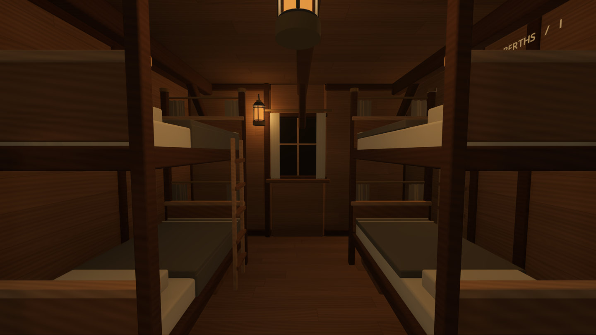
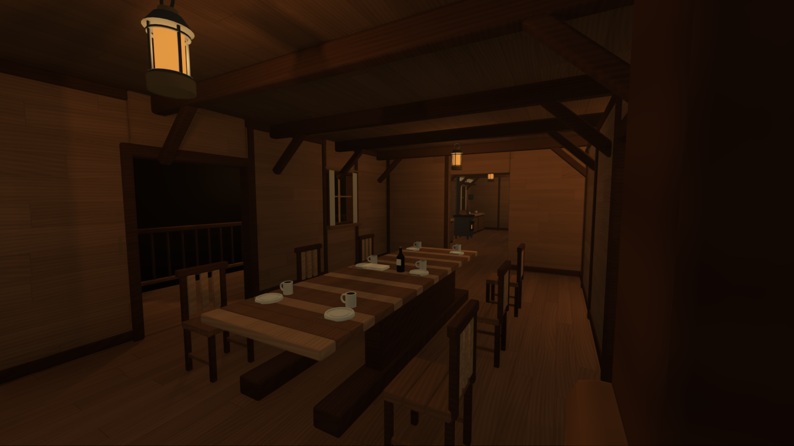
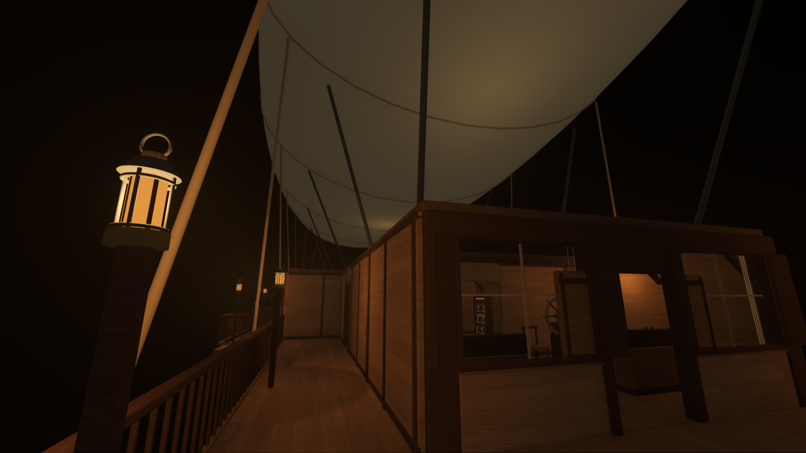

# NOCTURNE — Godot Flyship

검은 밤을 항해하는 **NOCTURNE — 1886년 건조된 목조 스팀펑크 비행선**. 낮은 들보, 좁은 판자 복도, 이층 침대와 작은 식당, 증기 기관이 가득한 3D 1인칭 탐험 시뮬레이션입니다. 창밖으로 별이나 다른 풍경은 보이지 않습니다.






## 실행

- **Godot 4.6.1 이상 Standard 버전**에서 `project.godot`을 가져오고 **F5**를 누르세요. .NET은 필요하지 않습니다.
- 이 작업 폴더에서는 **`Play.cmd`를 더블클릭**해 바로 실행할 수 있습니다. 로컬 검증용 Godot 엔진은 `.tools/godot/`에 있습니다. 엔진 자체는 Git에 포함하지 않습니다.
- **`builds/Nocturne.exe`**는 설치 없이 실행하는 로컬 Windows 미리보기입니다. 같은 폴더의 `Nocturne.pck`가 필요합니다. 편집기 바이너리를 런타임으로 포함한 개발용 패키지이며, 배포 최적화된 정식 빌드는 아래 내보내기 설정으로 만들 수 있습니다. 빌드 파일은 Git에 포함하지 않습니다.
- 기본 렌더러는 **Forward+**입니다. Vulkan을 지원하는 외장 GPU를 권장합니다. 저사양 기기는 실행 시 `--rendering-method gl_compatibility`로 대체 렌더러를 선택할 수 있습니다. 이 모드에서는 입체 안개와 일부 간접광 효과가 제외됩니다.
- 처음 실행할 때 GPU 셰이더 준비로 잠시 지연될 수 있습니다.

## 조작

| 입력 | 동작 |
| --- | --- |
| Enter / 시작 버튼 | 선내 진입 |
| WASD / 방향키 | 이동 |
| 마우스 | 시점 회전 |
| Shift | 빠르게 이동 |
| Ctrl | 앉기 |
| F | 손전등 켜기 / 끄기 |
| E | 격벽문 열기·닫기 / 선내 기록 읽기 |
| M / Tab | 현재 위치가 표시되는 선내 지도 |
| Esc | 일시정지 메뉴 / 지도·기록 닫기 |

메뉴에서 음량, 카메라 흔들림, 그래픽 효과를 조절할 수 있습니다. 승선 후에는 자유롭게 탐험하며, 목표·적·전투·비행선 조종·플레이어 외형은 없습니다.

## 공간

생활 공간의 길이를 약 **45m**로 줄이고 **중앙 복도 폭을 7.2m에서 1.8m로** 좁혔습니다. 실내 약 **409㎡**, 외부 통로·갑판·발코니 약 **176㎡**입니다. 방과 가구 사이를 실제로 이동하는 좁은 통로와 외부를 거쳐 돌아오는 순환 동선으로 구성됩니다.

- **Passage** — 1.8m 폭의 낮은 목조 복도, 가까이 이어지는 선실 문과 배관.
- **Wheelhouse / Chart Room** — 목재 조타륜, 아날로그 계기판, 종이 해도와 책장, 전면 창.
- **Crew Quarters** — 별도의 두 선실, 커튼·매트리스·이불·베개·사다리가 있는 이층 침대 8자리.
- **Captain's Cabin** — 침대와 천개, 책상·의자·책장·옷장·개인 기록.
- **Mess Room** — 긴 식탁, 의자 6개, 접시·잔·수저, 발코니로 열리는 문.
- **Galley** — 주방 난로와 주전자, 식료품 선반, 조리대와 통.
- **Engine Room / Workshop** — 압축한 왕복 기관, 보일러·구리 배관·회전 플라이휠, 정비 작업대.
- **Cargo Hold** — 나무 상자와 통이 쌓인 좁은 화물실, 발코니로 이어지는 두 번째 출입구.
- **Foredeck / Port & Starboard Walkways / Balcony** — 직접 걸을 수 있는 외부 갑판·양현 통로·발코니. 목조 난간, 계류 장치, 랜턴, 밧줄, 커다란 캔버스 기낭과 외부 프로펠러를 볼 수 있습니다.

## 그래픽과 사운드

목재 판재·불규칙한 나뭇결·옹이·직물·가죽·밧줄의 절차적 재질, 부드러운 베벨 모서리, 은은한 간접광과 안개를 사용합니다. 금속의 거칠기를 높이고 반사율·미세 요철·발광을 낮춰 날카로운 하이라이트와 번쩍임을 줄였습니다. 조명은 따뜻한 랜턴 중심입니다. 목재 발걸음·선체 삐걱임·부드러운 기계 저음과 바깥바람을 직접 합성하며, 실내외 이동에 따라 사운드가 바뀝니다.

모든 게임 모델·셰이더·합성 음향은 이 프로젝트 안에서 생성됩니다. 유료 에셋, 외부 다운로드, API 키, 인터넷 연결이 필요하지 않습니다. 폰트는 운영체제의 시스템 폰트를 사용합니다. Godot 엔진의 라이선스는 [Godot 공식 라이선스](https://godotengine.org/license/)를 따릅니다.

## 개발 구조

| 경로 | 역할 |
| --- | --- |
| `scenes/main.tscn` | 시작 씬 |
| `scripts/world.gd` | 복도·외부 선체·기낭·조명·문과 기록 상호작용 |
| `scripts/ship_architecture.gd` | 목조 벽·창·문·난간·구조 부재 |
| `scripts/interior_layout.gd` | 각 선실·식당·주방·기관실의 배치 |
| `scripts/furnishings.gd` | 침대·식탁·의자·책장·통·난로·랜턴 |
| `scripts/machinery.gd` | 애니메이션 기계와 소품 모듈 |
| `scripts/geometry.gd` | 크기별로 캐시되는 베벨 메시 |
| `scripts/materials.gd`, `shaders/` | 재질과 화면 효과 |
| `scripts/player.gd` | 몸체 없는 1인칭 이동과 손전등 |
| `scripts/interface.gd` | 시작·메뉴·HUD·지도·기록 |
| `scripts/ambience.gd` | 합성 사운드 |

장면은 실행 시 조립됩니다. 실내 배치는 `interior_layout.gd`, 복도·외부 배치와 지도 구역은 `world.gd`에서 수정하세요. 모델링 도구나 외부 플러그인 없이 같은 결과가 재현됩니다. 저장된 대형 씬을 편집하는 방식이 아닌 코드 기반 모듈 방식입니다.

## 검증

Godot 4.6.1 / Windows / NVIDIA RTX 3060 Laptop GPU에서 실행하고 실제 화면을 확인했습니다.

목조 버전 기준 **18개 실제 이동 경로·113개 검사 통과**. 13개 문의 통과·차단, 실내외 연결, 창과 난간 충돌, 문 끼임 방지, 지도·메뉴·기록 UI를 검증했습니다.

```text
godot --headless --path . -- --smoke-test
godot --headless --path . --script tests/traversal.gd
godot --headless --path . --script tests/interface_smoke.gd
```

이동 검사는 플레이어의 실제 물리 이동으로 각 선실과 실외 갑판·발코니에 도달하는지, 닫힌 문·창·난간이 이동을 막는지, 열린 문은 통과할 수 있는지, 문이 플레이어를 끼우지 않는지 확인합니다. 렌더링 확인용 `--capture-tour`는 각 구역의 PNG를 `captures/`에 저장합니다.

Windows 내보내기 설정은 `export_presets.cfg`에 있습니다. 배포 실행 파일을 만들 때는 사용하는 Godot 버전에 맞는 공식 Export Templates를 설치하고 **Windows Desktop** 프리셋으로 내보내세요.
